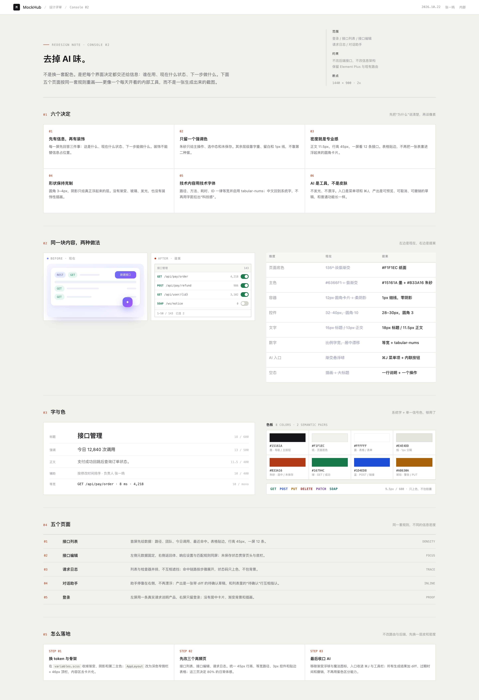

# MockHub · Console 02 设计稿

> 命题：去掉“AI 生成的后台”那股味。  
> 结论：不是换一套紫色，而是把界面的每个决定交还给信息。



## 五个页面

| # | 页面 | 设计主张 | 预览 |
| --- | --- | --- | --- |
| 01 | 接口列表 | 首屏先给数据，表格贴边，一屏 12 条 | [HTML](01-api-list.html) · [PNG](screens/01-api-list.png) |
| 02 | 接口编辑 | 左侧元数据固定，右侧返回体 + 响应设置 + 规则同屏 | [HTML](02-api-edit.html) · [PNG](screens/02-api-edit.png) |
| 03 | 请求日志 | 列表与检查器并排，命中链路按步骤展开 | [HTML](03-logs.html) · [PNG](screens/03-logs.png) |
| 04 | 对话助手 | 助手停靠右侧，产出是带 diff 的待确认草稿 | [HTML](04-assistant.html) · [PNG](screens/04-assistant.png) |
| 05 | 登录 | 用一条真实请求说明产品，不放居中卡片和插画 | [HTML](05-login.html) · [PNG](screens/05-login.png) |

## 视觉规则

### 1. 先有信息，再有装饰

每屏先回答：这是什么、现在什么状态、下一步做什么。
装饰不能替信息占位置，所以去掉了：

- 淡紫渐变页面底色
- 12px 圆角 + 柔和投影的“卡片套表格”
- 每个标签都包一层彩色胶囊
- 右下角呼吸的渐变 AI 悬浮球

### 2. 一个强调色，剩下交给字重和细线

| 角色 | 值 | 用法 |
| --- | --- | --- |
| 墨 | `#15161A` | 侧栏、主按钮、正文 |
| 纸 | `#F1F1EC` | 页面底色 |
| 面 | `#FFFFFF` | 表格、表单、面板 |
| 线 | `#E4E4DD` | 1px 分隔，替代阴影 |
| 朱砂 | `#B33A16` | 选中、未保存、待确认，只做信号不做背景 |
| 语义色 | `#16794C` / `#A8630A` / `#A92A22` | GET / PUT / DELETE，只上色不包胶囊 |

主按钮用墨黑，朱砂只出现在 2px 的选中线、未保存圆点和待确认边框上。整个界面没有第二种“品牌色”。

### 3. 密度就是专业感

- 正文 `11.5px / 1.45`，表头 `9.5px`，路径与数字全部等宽
- 表格行高 `45px`，一屏 12 条；表头 `29px`
- 控件高度 `28–30px`，圆角 `3px`
- 只有浮层有阴影，静态容器一律 1px 细线
- 中文用系统字（PingFang SC），英文与代码用 SF Mono，不靠字距制造“科技感”

### 4. AI 是工具，不是皮肤

- 入口从“悬浮球”改为顶栏的“助手 ⌘J”和工具栏里的普通按钮
- 助手停靠在右侧，不遮挡列表；打开时列表缩窄，而不是盖一层毛玻璃
- 生成结果是“待确认草稿”，带 diff、过期时间、应用 / 取消 / 撤销
- “AI”只作为 8px 的描边小标签出现，不用渐变、发光或紫色描边
- 请求日志里的“解释这次匹配”是一个普通文字按钮，旁边标 AI，不抢占主操作

## 文件结构

```
design/console-v2/
├── 00-overview.html          设计总览（原则 / 对照 / 字色 / 页面索引 / 落地）
├── 01-api-list.html          接口列表
├── 02-api-edit.html          接口编辑
├── 03-logs.html              请求日志 + 检查器
├── 04-assistant.html         接口列表 + 停靠助手
├── 05-login.html             登录
├── assets/console.css        全部 token 与组件样式
├── build/shot.sh             2x 截图脚本
└── screens/                  预览图
```

## 重新截图

```bash
bash build/shot.sh
```

脚本默认使用 Playwright 的 `chrome-headless-shell`。如路径不同：

```bash
CHROME=/path/to/chrome-headless-shell bash build/shot.sh
```

## 落地顺序（不包含在本设计稿内）

1. **Token 与骨架**：`frontend/src/styles/variables.scss` 去掉渐变和第二主色；`AppLayout.vue` 改成 212px 深色侧栏 + 46px 顶栏；页面容器去圆角、去阴影。
2. **三个高频页**：`ApiList.vue`、`ApiEdit.vue`、`LogView.vue`。先统一行高、等宽路径、贴边表格和 3px 控件，这三页决定 80% 的日常体感。
3. **AI 收口**：`frontend/src/components/ai` 与 `AppLayout.vue` 的悬浮入口，改为 `⌘J` + 右侧停靠面板；所有生成结果复用同一套“草稿 / diff / 确认”结构。
4. **Element Plus 覆写**：优先改 CSS 变量（`--el-border-radius-base`、`--el-color-primary`、`--el-box-shadow-light`），再改局部 `element-overrides.scss`，避免逐页写样式。

## 边界

- 这是视觉提案，没有接入真实接口；数据为演示数据。
- 未覆盖暗色主题、移动端与图表页（`Stats.vue`）。
- 侧栏团队筛选被收进列表工具栏；如果团队切换是最高频操作，可以在侧栏底部恢复一个紧凑的团队切换器，而不是常驻大树。
